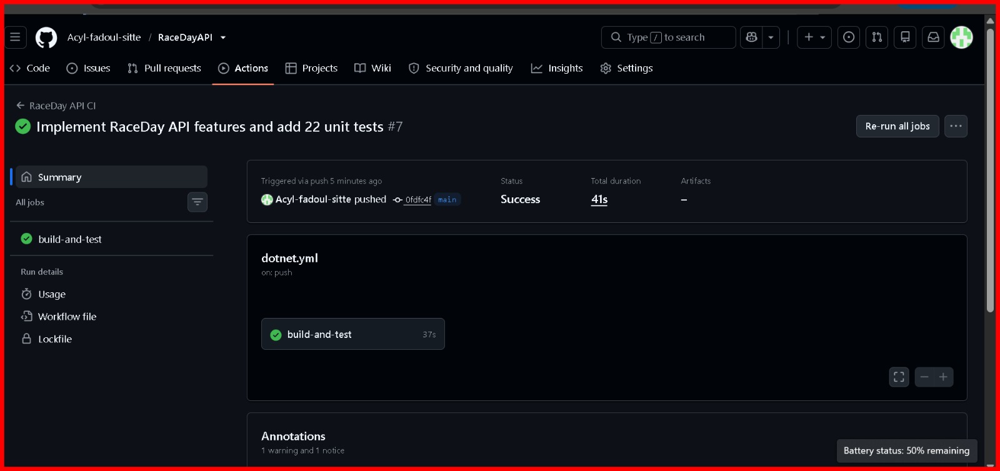

# RaceDay API

## 1. Project Overview

RaceDay is a web-based event management system designed for the South African road running, walking, and cycling community.

The purpose of the system is to provide one platform where event organisers can manage sporting events and participants can register for events, manage their enrolments, and view their race results.

The system aims to reduce the problems caused by paper-based registrations, spreadsheets, and disconnected communication.

This repository contains the planning, database design, and RESTful API development for the RaceDay system.

## 2. Purpose of the System

The main purpose of RaceDay is to make the management of running, walking, and cycling events more organised and efficient.

The system supports the following functionality:

- User registration and login
- Role-based authentication and authorisation
- Event management
- Event categories
- Participant enrolments
- Race result management
- User profile management
- SQL Server database integration
- RESTful API endpoints
- Automated unit testing
- Continuous integration using GitHub Actions

## 3. User Roles

### Organiser

The Organiser manages sporting events on the RaceDay system.

The Organiser can:

- Register and log in.
- Create and manage their own events.
- Create and manage event categories for their events.
- View enrolments for their own events.
- Capture and update race results for their events.
- View event information.

### Participant

The Participant uses the system to register for sporting events.

The Participant can:

- Create an account and log in.
- View available events.
- View event categories.
- Enrol in an event using an available category.
- View their own enrolments.
- Cancel their own enrolments where permitted.
- View their own race results.
- View and update their profile.

Access to protected API endpoints is controlled using JWT authentication and role-based authorisation.

## 4. Technologies Used

The project uses the following technologies:

- C#
- ASP.NET Core Web API
- .NET 10
- Microsoft SQL Server
- Entity Framework Core
- Entity Framework Core Code-First
- BCrypt password hashing
- JSON Web Tokens (JWT)
- Swagger / OpenAPI
- xUnit unit testing
- Entity Framework Core InMemory for unit tests
- Git and GitHub
- GitHub Actions for continuous integration
- Visual Studio Code
- SQL Server Management Studio (SSMS)
- Postman for API testing

## 5. Project Structure

The main project files and folders include:

```text
RaceDayAPI/
│
├── Controllers/
│   ├── AuthController.cs
│   ├── UsersController.cs
│   ├── EventsController.cs
│   ├── CategoriesController.cs
│   ├── EnrolmentsController.cs
│   └── ResultsController.cs
│
├── Data/
│   └── RaceDayContext.cs
│
├── Models/
│   ├── User.cs
│   ├── Event.cs
│   ├── Category.cs
│   ├── Enrolment.cs
│   └── Result.cs
│
├── RaceDayAPI.Tests/
│   ├── RaceDayAPI.Tests.csproj
│   └── UnitTest1.cs
│
├── Migrations/
├── database/
│   └── RaceDay.sql
│
├── docs/
│   ├── API-Endpoint-Plan.md
│   ├── RaceDay-ERD.jpeg
│   ├── RaceDay.sql
│   └── SQL database screenshots
│
├── .github/
│   └── workflows/
│       └── dotnet.yml
│
├── Program.cs
├── RaceDayAPI.csproj
├── RaceDayAPI.http
└── README.md
```

The structure above describes the main project files. Some folders or filenames may differ depending on the files included in the repository.

## 6. Documentation and Database Design

### Entity Relationship Diagram

The Entity Relationship Diagram (ERD) illustrates the database entities, attributes, primary keys, foreign keys, and relationships between the tables.

The diagram supports the planning of the RaceDay database structure.

The ERD is available in `docs/RaceDay-ERD.jpeg`.

### API Endpoint Plan

The API Endpoint Plan documents the intended RESTful API endpoints, HTTP methods, routes, required roles, request bodies, and expected response codes.

The document is available in `docs/API-Endpoint-Plan.md`.

### SQL Database Script

The SQL script defines the database structure, tables, relationships, constraints, and sample data used during database development.

The script is available in `docs/RaceDay.sql`.

### SQL Execution Evidence

Screenshots of SQL Server Management Studio are included as evidence of the database script execution and database structure.

## 7. Database Configuration

The project uses Microsoft SQL Server as its relational database.

The main database entities include:

- Users
- Events
- Categories
- Enrolments
- Results
- Routes

### Local SQL Server Configuration

The local development environment uses:

- Server instance: `localhost\SQLEXPRESS`
- Database: `RaceDayDB`
- Authentication: Windows Authentication
- Trust Server Certificate: Enabled, where required by the local connection configuration

The connection string is configured in the application's configuration files.

For security, do not commit passwords, private credentials, or production connection strings to GitHub.

### Creating the Database

To create or prepare the database:

1. Open SQL Server Management Studio.
2. Connect to the `localhost\SQLEXPRESS` server instance.
3. Open `docs/RaceDay.sql`.
4. Review the SQL script.
5. Execute the script if the database has not already been created.
6. Confirm that `RaceDayDB` and its tables appear in Object Explorer.

Do not execute a database-creation script unnecessarily if it would overwrite existing data.

## 8. RESTful API Development

The RaceDay API is developed using ASP.NET Core Web API and Entity Framework Core.

The API separates its functionality into controllers, models, and the database context.

### Authentication

The authentication functionality includes:

- User registration
- User login
- Password hashing using BCrypt
- JWT generation
- Token-based authentication
- Role-based authorisation for protected endpoints

The supported user roles are `Organiser` and `Participant`.

### Event Management

The Events API supports retrieving events and managing events according to the user's role and ownership permissions.

Organisers can create, update, and delete their own events. Authenticated users can view event information.

### Category Management

The Categories API supports retrieving event categories and allows organisers to manage categories for events they own.

### Enrolment Management

The Enrolments API supports participant enrolments, retrieval of a participant's own enrolments, and enrolment cancellation where permitted.

The API validates event and category relationships and checks enrolment conditions.

### Result Management

The Results API supports recording and updating event results by authorised organisers and allows participants to retrieve their own results.

Result validation includes checks for result status, finishing time, and position.

### User Profiles

The Users API provides profile-related functionality subject to the configured authentication and authorisation rules.

## 9. Running the API Locally

### Prerequisites

Before running the project, ensure that the following are installed:

- .NET 10 SDK
- Microsoft SQL Server
- SQL Server Management Studio
- Visual Studio Code or another compatible code editor
- Git

### Steps to Run

1. Clone or download the repository from GitHub.
2. Open the project folder in Visual Studio Code.
3. Confirm that the SQL Server instance and database are configured.
4. Check the application's connection string and JWT settings.
5. Open the terminal in the project directory.
6. Restore the dependencies:

```powershell
dotnet restore .\RaceDayAPI.csproj
```

7. Build the API:

```powershell
dotnet build .\RaceDayAPI.csproj
```

8. Run the API:

```powershell
dotnet run --project .\RaceDayAPI.csproj
```
9. Open your browser and navigate to:
   http://localhost:5142/swagger

   Note: This address is for local development. The port may differ on another computer.
If Swagger is enabled for the current environment, open the Swagger UI address provided by the application to inspect and test the endpoints.

## 10. Unit Testing

The project includes a separate xUnit test project named `RaceDayAPI.Tests`.

The test project uses Entity Framework Core InMemory to test API controller behaviour without requiring the production SQL Server database for every test.

The tests cover scenarios including:

- Successful and unsuccessful registration
- Successful and unsuccessful login
- Event management
- Authorisation and access restrictions
- Enrolment validation
- Result creation and validation
- Duplicate result prevention
- Organiser ownership restrictions

### Running the Tests

Run the following command from the repository root:

```powershell
dotnet test .\RaceDayAPI.Tests\RaceDayAPI.Tests.csproj --configuration Release
```

### Latest Local Test Results

The latest recorded local test run completed successfully:

- Total tests: 22
- Passed: 22
- Failed: 0
- Skipped: 0

The API and test project also built successfully during that run.

These results describe the local test run. The latest GitHub Actions workflow should also be checked to confirm that the automated build and tests pass on GitHub.

## 11. Continuous Integration and GitHub Actions

GitHub Actions is used to automate the build and test process.

The workflow is stored in:

`.github/workflows/dotnet.yml`

The workflow is configured to run when changes are pushed to the `main` branch or when a pull request targets that branch.

The workflow performs the following tasks:

1. Checks out the repository.
2. Sets up the .NET 10 SDK.
3. Restores the API dependencies.
4. Builds the API in Release configuration.
5. Runs the automated unit tests.

### GitHub Actions Evidence

The screenshot below shows the successful GitHub Actions workflow for the RaceDay API.



The successful workflow provides evidence that the automated build-and-test process completed successfully for the recorded run.

Workflow history can be viewed here:

[RaceDayAPI GitHub Actions](https://github.com/Acyl-fadoul-sitte/RaceDayAPI/actions)

## 12. Part 1 Planning and Database Deliverables

The Part 1 work includes:

- Entity Relationship Diagram
- REST API Endpoint Plan
- SQL Server database script
- Database relationships and constraints
- Sample data
- GitHub repository
- CI/CD workflow and supporting evidence

The relevant documents and evidence are stored in the `docs` folder.

## 13. Part 2 Development and Testing

Part 2 focuses on developing the RaceDay RESTful API.

The implementation includes authentication, user roles, event management, category management, enrolments, results, database integration, and automated testing.

The project also includes a GitHub Actions workflow for automated building and testing.

The API should be tested with valid requests, invalid requests, missing or invalid tokens, and users with insufficient permissions.

## 14. Demonstration Video

An unlisted YouTube demonstration video will be provided for the assignment submission.

The presentation should demonstrate:

- The project structure
- The database design and ERD
- The API endpoint plan
- The SQL Server database
- API endpoints using Swagger or Postman
- User registration and login
- JWT authentication and role-based access control
- Event, category, enrolment, and result functionality
- Unit test execution
- The successful GitHub Actions workflow

**YouTube video:** To be added after the demonstration has been recorded and uploaded.

## 15. Repository

GitHub repository:

[https://github.com/Acyl-fadoul-sitte/RaceDayAPI](https://github.com/Acyl-fadoul-sitte/RaceDayAPI)

GitHub Actions:

[https://github.com/Acyl-fadoul-sitte/RaceDayAPI/actions](https://github.com/Acyl-fadoul-sitte/RaceDayAPI/actions)

## 16. Project Status

The RaceDay project contains planning and database documentation alongside an ASP.NET Core RESTful API implementation.

The current API project includes authentication, role-based access control, event management, category management, enrolments, results, and unit tests.

The latest local test run recorded 22 passing tests with no failures, and the pushed code received a successful GitHub Actions workflow run.

Remaining submission tasks include verifying the final README evidence, checking endpoint documentation and assignment requirements, confirming the required Git commit history, and adding the completed demonstration video link.
